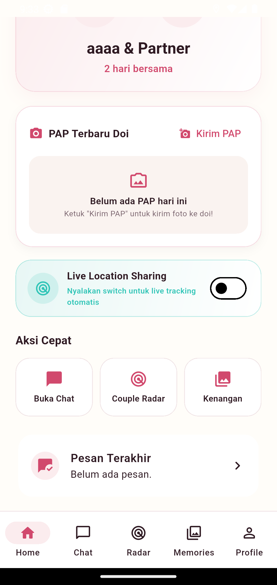
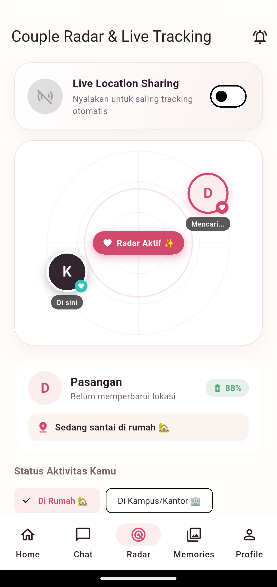
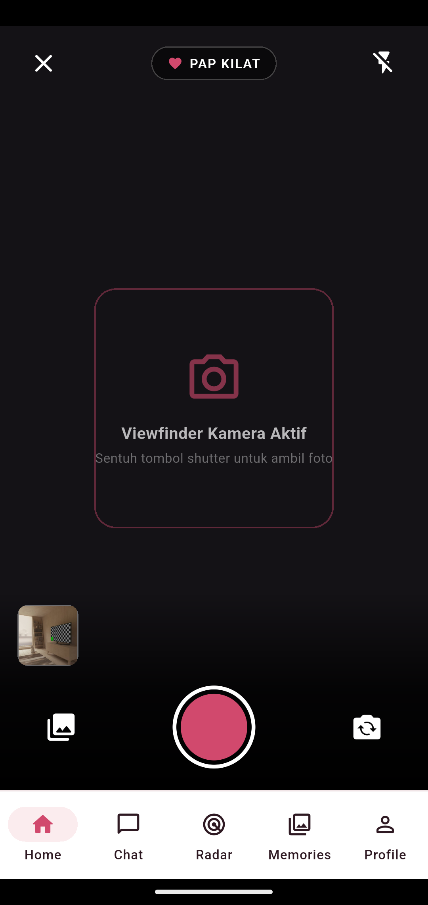
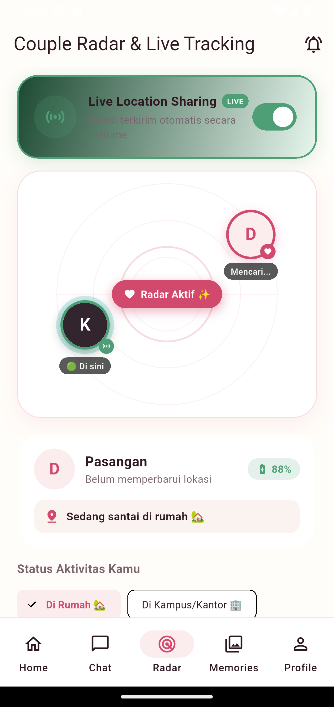
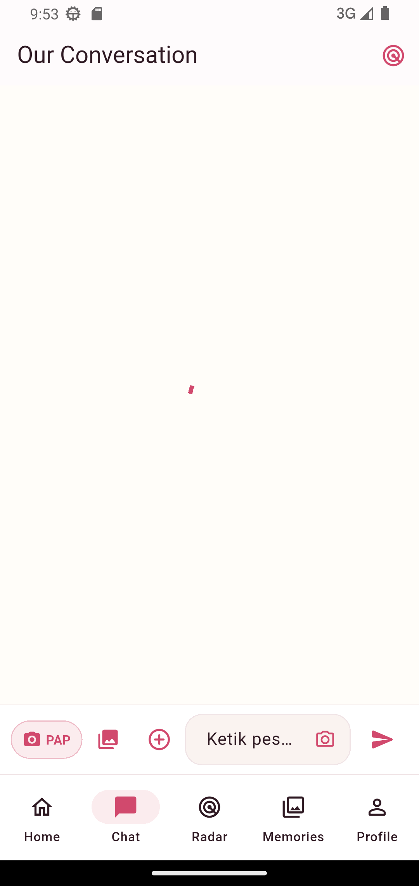

# 💖 UsOnly — Private Couple Space

<p align="center">
  
</p>

<p align="center">
  <strong><em>"Just us, always."</em></strong><br/>
  An intimate, ultra-private mobile application engineered exclusively for two people in a relationship.<br/>
  Zero public feeds. Zero follower counts. Zero ads. Just you and your partner.
</p>

<p align="center">
  <a href="https://flutter.dev"></a>
  <a href="https://dart.dev"></a>
  <a href="https://firebase.google.com"></a>
  <a href="https://riverpod.dev"></a>
  <a href="https://m3.material.io"></a>
  
  
</p>

---

## 📖 Table of Contents

- [✨ Overview & Philosophy](#-overview--philosophy)
- [📱 Visual Showcase](#-visual-showcase)
- [🌟 Key Features](#-key-features)
  - [1. 🛰️ Find Hub & Live Location Radar](#1-️-find-hub--live-location-radar)
  - [2. 📸 PAP Kilat & In-App Photo Editor](#2--pap-kilat--in-app-photo-editor)
  - [3. 💬 Private 1-on-1 Real-time Chat](#3--private-1-on-1-real-time-chat)
  - [4. 💑 Couple Dashboard & Milestones](#4--couple-dashboard--milestones)
  - [5. 📔 Shared Memories Timeline](#5--shared-memories-timeline)
  - [6. 🔐 Zero-Leak Pairing & Strict Security](#6--zero-leak-pairing--strict-security)
  - [7. 🔔 In-App & Push Notifications](#7--in-app--push-notifications)
- [🏛️ System Architecture](#️-system-architecture)
- [📂 Project Directory Structure](#-project-directory-structure)
- [🛠️ Tech Stack & Dependencies](#️-tech-stack--dependencies)
- [🚀 Getting Started & Setup Guide](#-getting-started--setup-guide)
  - [Prerequisites](#prerequisites)
  - [Step 1: Clone the Repository](#step-1-clone-the-repository)
  - [Step 2: Firebase Console Configuration](#step-2-firebase-console-configuration)
  - [Step 3: FlutterFire CLI Initialization](#step-3-flutterfire-cli-initialization)
  - [Step 4: Deploy Firebase Security Rules](#step-4-deploy-firebase-security-rules)
  - [Step 5: Firebase Cloud Functions Setup](#step-5-firebase-cloud-functions-setup)
  - [Step 6: Run Local Firebase Emulators (Optional)](#step-6-run-local-firebase-emulators-optional)
  - [Step 7: Run the Application](#step-7-run-the-application)
- [🔒 Security Rules & Data Privacy](#-security-rules--data-privacy)
- [📱 Platform Permissions (Android / iOS)](#-platform-permissions-android--ios)
- [🧪 Testing & Quality Assurance](#-testing--quality-assurance)
- [❓ Frequently Asked Questions & Troubleshooting](#-frequently-asked-questions--troubleshooting)
- [📄 License](#-license)

---

## ✨ Overview & Philosophy

Modern social media platforms are built for broadcast audiences, vanity metrics, and public consumption. **UsOnly** takes the opposite stance: **radical privacy and intimacy**.

Built from the ground up using **Flutter** and **Pure Firebase Native**, UsOnly creates an isolated, encrypted digital sanctuary strictly bounded to two verified partners. 

### Core Design Principles:
1. **Two-Person Hard Limit (`N = 2`)**: Every space, chat room, memory vault, and radar tracking channel is locked to strictly two authenticated user IDs at both database and security rule levels.
2. **Zero External Servers**: No third-party PHP, Laravel, Express VPS, or external databases. Pure serverless Firebase (Auth, Firestore, Cloud Storage, Cloud Functions, and FCM) ensures 99.99% uptime, end-to-end data integrity, and essentially **$0/month hosting cost** under Firebase's generous free tier.
3. **Immersive Romantic Aesthetic**: Tailored with an intimate Material 3 romantic palette (*Rose 500, Blush Pink, Deep Plum, Midnight Surface*), complete with smooth dark mode adaptation and micro-animations.

---

## 📱 Visual Showcase

| Home Dashboard | Find Hub Live Radar | PAP Kilat Camera | Photo Editor & Moods | Private Chat |
| :---: | :---: | :---: | :---: | :---: |
|  |  |  |  |  |
| *Days together counter & quick actions* | *Live radar pulse & 6 map themes* | *Instant selfie viewfinder & flash* | *Time badge & mood chip selector* | *Realtime chat with media cards* |

---

## 🌟 Key Features

### 1. 🛰️ Find Hub & Live Location Radar
- **Live Location Streaming**: Real-time GPS coordinate synchronization between partners with battery-efficient intervals using `geolocator` and `flutter_map`.
- **Dynamic Pulse Radar**: Animated pulsing radar circle centered on partner's coordinate with distance calculation in kilometers/meters and live bearing.
- **6 Map Tile Themes**:
  - 🗺️ *Google Maps Roadmap*
  - 🛰️ *Google Maps Satellite Hybrid*
  - ⛰️ *Google Maps Terrain*
  - 🎨 *Carto Voyager (Clean Minimalist)*
  - 🌙 *Carto Dark (Find Hub Cyber-Romantic)*
  - 🌍 *OpenStreetMap Standard*
- **Partner Status Tags**: Quick preset activity chips (*"Di Rumah 🏡"*, *"Di Kampus/Kantor 🏢"*, *"Sedang di Jalan 🚗"*, *"Lagi Santai ☕"*, *"Lagi Belanja 🛍️"*, *"Lagi Bareng Kamu 💕"*).
- **1-Tap Navigation**: Launch turn-by-turn Google Maps Directions straight to your partner's exact coordinate with one touch.
- **Location Snapshot to Chat**: Share static location cards directly into your private chat thread.
- **"Ping Partner" Nudge**: Send an instant high-priority notification nudging your partner to toggle their live location.

---

### 2. 📸 PAP Kilat & In-App Photo Editor
- **Instant "Post-A-Picture" (PAP)**: Locket-inspired quick camera flow built with `camera` package.
- **Selfie-First Experience**: Intelligently prioritizes front-facing camera for quick candid selfie updates.
- **WhatsApp-Style Recent Photos Tray**: Bottom horizontal gallery strip allowing 1-tap selection of photos taken earlier.
- **In-App Photo Editor & Timestamp Watermark**:
  - Real-time timestamp watermark badge: `US ONLY • HH:mm`.
  - Intimate mood chips: *"Lagi kangen kamu ❤️"*, *"Lagi santai nih ☕"*, *"Lagi kerja/belajar 💻"*, *"Lagi di jalan 🚗"*, *"Lagi makan 🍕"*, *"Mau tidur 😴"*.
  - Custom caption input and instant dispatch to Chat or Memories.

---

### 3. 💬 Private 1-on-1 Real-time Chat
- **Sub-Second Firestore Streaming**: Reactive message synchronization via Firestore snapshot listeners with zero lag.
- **Rich Message Types**:
  - Clean conversational text bubbles.
  - High-resolution compressed image bubbles with fullscreen tap-to-zoom.
  - Interactive Location Pin cards displaying coordinates, status labels, and quick map openers.
- **Read Receipts & Delivery Indicators**: Message delivery ticks (*Sent*, *Read by Partner*).
- **Custom In-App Media Picker**: Integrated modal sheet supporting live camera capture or multi-album gallery selection.

---

### 4. 💑 Couple Dashboard & Milestones
- **Days Together Counter**: Real-time anniversary counter tracking total days elapsed since pairing.
- **Partner Presence & Status**: Live online indicators, avatar overlays, and current activity status pills.
- **Home PAP Locket Widget**: Preview the latest PAP received from your partner directly on the home screen.
- **Live Radar Quick Card**: Instant glance at partner distance, battery, and last reported location right from the dashboard.

---

### 5. 📔 Shared Memories Timeline
- **Digital Relationship Scrapbook**: Chronological feed of shared couple milestones, dates, and trips.
- **Multi-Photo Attachments**: Upload memorable moments to Firebase Cloud Storage with dedicated romantic captions and memory dates.
- **Permanent Archiving**: High-fidelity storage isolated exclusively to the couple space.

---

### 6. 🔐 Zero-Leak Pairing & Strict Security
- **Expiring 6-Character Connection Codes**: Cryptographically generated alphanumeric codes valid for exactly 10 minutes.
- **Atomic Two-Member Enforcement**: Firestore security rules and backend transaction checks strictly forbid a 3rd member from joining or intercepting data.
- **Dual-Layer Architecture**:
  - Primary: Firebase Cloud Functions 2nd Gen (`createPairingCode`, `redeemPairingCode`).
  - Resilient Fallback: Built-in atomic Firestore transaction fallback ensuring pairing works seamlessly even if Cloud Functions are offline or during free-tier testing!

---

### 7. 🔔 In-App & Push Notifications
- **In-App Toast Banner**: Floating animated top banner notifying you when a partner sends a message, turns on live radar, or shares a PAP while you are inside the app.
- **Firebase Cloud Messaging (FCM)**: Background push notifications for incoming chats and location pings.
- **Dedicated Notifications Center**: In-app history log for all alerts and pairing events.

---

## 🏛️ System Architecture

```
                          ┌─────────────────────────────────────┐
                          │         UsOnly Flutter App          │
                          │   (Dart 3.5+ / Material 3 M3 Theme)  │
                          └──────────────────┬──────────────────┘
                                             │
                      ┌──────────────────────┼──────────────────────┐
                      ▼                      ▼                      ▼
             ┌─────────────────┐    ┌─────────────────┐    ┌─────────────────┐
             │ Riverpod State  │    │ GoRouter Guards │    │ In-App Modules  │
             │   Controllers   │    │  (Auth/Pairing) │    │ Camera/Location │
             └────────┬────────┘    └────────┬────────┘    └────────┬────────┘
                      │                      │                      │
                      └──────────────────────┼──────────────────────┘
                                             │
                           HTTPS / gRPC / WebSockets (TLS 1.3)
                                             │
                      ┌──────────────────────┴──────────────────────┐
                      │    Google Firebase Native Cloud Platform    │
                      └──────────────────────┬──────────────────────┘
                                             │
         ┌───────────────────┬───────────────┼───────────────┬───────────────────┐
         ▼                   ▼               ▼               ▼                   ▼
┌─────────────────┐ ┌─────────────────┐ ┌─────────┐ ┌─────────────────┐ ┌─────────────────┐
│  Firebase Auth  │ │ Cloud Firestore │ │ Storage │ │ Cloud Functions │ │ Cloud Messaging │
│ (Email/Password │ │  (NoSQL Realtime│ │ (Media  │ │  (TypeScript    │ │  (Push Notifs / │
│  & Token Auth)  │ │   Couple Store) │ │  < 15MB)│ │   v2 Endpoints) │ │   Partner Ping) │
└─────────────────┘ └─────────────────┘ └─────────┘ └─────────────────┘ └─────────────────┘
```

### Presentation & Business Logic Flow
```
UI (Screens / Widgets)
       │
       ▼ (User Action / Event)
Riverpod Notifier / Controller
       │
       ▼ (Calls Contract)
Repository Implementation (Data Layer)
       │
       ▼ (Direct Reactive Stream / Atomic Transaction)
Cloud Firestore / Storage / Cloud Functions
```

---

## 📂 Project Directory Structure

```
usonly/
├── android/                           # Android native configuration & manifests
├── ios/                               # iOS native configuration & Podfile
├── functions/                         # Firebase Cloud Functions (TypeScript v2)
│   ├── src/
│   │   └── index.ts                   # Pairing code generator, redeemer & FCM triggers
│   ├── package.json
│   └── tsconfig.json
├── docs/                              # Project documentation & architecture notes
│   ├── api.md
│   └── architecture.md
├── lib/
│   ├── app/
│   │   ├── app.dart                   # UsOnlyApp root entry widget
│   │   ├── router.dart                # GoRouter config with auth & pairing route guards
│   │   └── theme/
│   │       ├── app_colors.dart        # Romantic color palette (Rose, Blush, Surface)
│   │       └── app_theme.dart         # Material 3 light and dark theme configurations
│   ├── features/
│   │   ├── auth/                      # Authentication (Login, Register, Forgot Password)
│   │   │   ├── data/auth_repository.dart
│   │   │   ├── domain/auth_state.dart & user_model.dart
│   │   │   └── presentation/
│   │   ├── pairing/                   # Expiring 6-char pairing system & onboarding
│   │   │   ├── data/pairing_repository.dart
│   │   │   └── presentation/ (create_code, enter_code, connection_success)
│   │   ├── home/                      # Dashboard, anniversary days counter, locket widget
│   │   │   └── presentation/ (home_screen.dart, main_shell_screen.dart)
│   │   ├── chat/                      # Realtime chat, location cards, media bubbles
│   │   │   ├── data/chat_repository.dart
│   │   │   ├── domain/message_model.dart
│   │   │   └── presentation/chat_screen.dart
│   │   ├── tracking/                  # Find Hub live radar, 6 map styles, directions
│   │   │   ├── data/location_repository.dart
│   │   │   ├── domain/location_model.dart
│   │   │   └── presentation/location_tracking_screen.dart
│   │   ├── media/                     # Hardware camera, PAP mode, WhatsApp-style editor
│   │   │   └── presentation/ (builtin_camera_screen, builtin_media_picker_sheet, ...)
│   │   ├── memories/                  # Shared photo scrapbook timeline
│   │   │   ├── data/memories_repository.dart
│   │   │   └── presentation/ (memories_screen, create_memory_screen)
│   │   ├── notifications/             # In-app toast banners & notification center
│   │   │   ├── data/notifications_repository.dart
│   │   │   └── presentation/ (in_app_notification_banner, notifications_screen)
│   │   └── profile/                   # User profile, photo upload, security & account settings
│   │       └── presentation/profile_screen.dart
│   ├── firebase_options.dart          # Multi-platform Firebase options (auto-generated)
│   └── main.dart                      # Flutter run entrypoint & Firebase initializers
├── firestore.rules                    # Production Firestore security rules (Strict N=2 limit)
├── firestore.indexes.json             # Composite query indexes for Firestore
├── storage.rules                      # Cloud Storage security rules (MIME & 15MB limits)
├── firebase.json                      # Firebase project & Emulator Suite configurations
└── pubspec.yaml                       # Flutter project dependencies & asset definitions
```

---

## 🛠️ Tech Stack & Dependencies

| Category | Technology | Usage |
| :--- | :--- | :--- |
| **Framework** | [Flutter 3.24+](https://flutter.dev) (Dart 3.5+) | Cross-platform mobile development |
| **State Management** | [flutter_riverpod 3.4.3](https://riverpod.dev) | Reactive state management, DI, stream watching |
| **Navigation** | [go_router 18.0.2](https://pub.dev/packages/go_router) | Declarative routing with pairing & auth guards |
| **Maps & Radar** | [flutter_map 8.3.2](https://pub.dev/packages/flutter_map) + [latlong2](https://pub.dev/packages/latlong2) | Tile rendering for 6 map layers & radar animations |
| **Location Services** | [geolocator 14.1.1](https://pub.dev/packages/geolocator) | Real-time GPS coordinate acquisition & distance |
| **Camera & Editor** | [camera 0.12.1](https://pub.dev/packages/camera) + [image 4.3.0](https://pub.dev/packages/image) | Hardware viewfinder, selfie flip, PAP photo editor |
| **Backend & Database**| [Cloud Firestore 6.10](https://firebase.google.com/docs/firestore) | Reactive NoSQL document store for chat & spaces |
| **Authentication** | [Firebase Auth 6.7](https://firebase.google.com/docs/auth) | Email/password, verification, password resets |
| **Cloud Storage** | [Firebase Storage 13.6](https://firebase.google.com/docs/storage) | Secure storage for couple media & avatars |
| **Push Notifications**| [Firebase Messaging 16.7](https://firebase.google.com/docs/cloud-messaging) | FCM partner push alerts & location pings |
| **Cloud Functions** | [Cloud Functions v2 (TypeScript)](https://firebase.google.com/docs/functions) | Cryptographic pairing code generation & redemption |
| **Image Caching** | [cached_network_image 4.0](https://pub.dev/packages/cached_network_image) | High-performance disk/memory photo caching |

---

## 🚀 Getting Started & Setup Guide

### Prerequisites
Make sure the following tools are installed on your machine:
- **Flutter SDK**: `^3.24.0` or higher (`flutter doctor` should show all green).
- **Node.js**: `v20.x` or higher (required for Firebase CLI & Functions).
- **Firebase CLI**:
  ```bash
  npm install -g firebase-tools
  ```
- **FlutterFire CLI**:
  ```bash
  dart pub global activate flutterfire_cli
  ```
- **Android Studio / Xcode**: Android SDK Platform-Tools 34+ and JDK 17+.

---

### Step 1: Clone the Repository
```bash
git clone https://github.com/your-username/usonly.git
cd usonly
flutter pub get
```

---

### Step 2: Firebase Console Configuration
1. Open the [Firebase Console](https://console.firebase.google.com/) and create a new project named **`usonly-app`** (or your custom name).
2. **Enable Authentication**:
   - Navigate to **Build > Authentication > Sign-in method**.
   - Enable **Email/Password** provider and save.
3. **Enable Cloud Firestore**:
   - Navigate to **Build > Firestore Database > Create database**.
   - Select your preferred cloud region (e.g. `asia-southeast1` or `nam5 (us-central)`).
   - Start in **Production mode**.
4. **Enable Cloud Storage**:
   - Navigate to **Build > Storage > Get started**.
   - Select your preferred bucket location matching your Firestore region.

---

### Step 3: FlutterFire CLI Initialization
Log in to your Firebase account from the terminal:
```bash
firebase login
```
Run `flutterfire configure` to generate native configurations:
```bash
flutterfire configure
```
Select your Firebase project and select target platforms (**Android**, **iOS**). This automatically updates `android/app/google-services.json` and creates `lib/firebase_options.dart`.

#### Android SHA-1 & SHA-256 Fingerprint
To ensure proper Firebase handshake on Android:
```bash
cd android
./gradlew signingReport
cd ..
```
Copy the `SHA1` and `SHA-256` keys from your `debug` variant and paste them into your Android app settings in the Firebase Console.

---

### Step 4: Deploy Firebase Security Rules
Deploy production Firestore and Storage security rules with a single command:
```bash
firebase deploy --only firestore:rules,storage
```

---

### Step 5: Firebase Cloud Functions Setup
Firebase Cloud Functions v2 operates the secure pairing protocol:
```bash
cd functions
npm install
npm run build
firebase deploy --only functions
cd ..
```

> [!NOTE]
> **Free Tier / Blaze Plan Note**:
> Deploying Cloud Functions requires the Firebase **Blaze (Pay-As-You-Go)** plan.
> Because couple applications are used by only 2 individuals, you will comfortably stay well inside Firebase's monthly free allowances:
> - **2,000,000 Cloud Function invocations / month** (FREE)
> - **50,000 Firestore reads / day** (FREE)
> - **20,000 Firestore writes / day** (FREE)
> - **5 GB Cloud Storage** (FREE)
> Your typical monthly bill will remain **$0.00**.
> 
> *Resilience Feature*: `PairingRepository` has an automatic atomic Firestore transaction fallback implemented. Even if Cloud Functions are not yet deployed, pairing will succeed gracefully!

---

### Step 6: Run Local Firebase Emulators (Optional)
If you want to test completely offline without connecting to live cloud servers:
```bash
firebase emulators:start
```
The Firebase Emulator Suite UI will be accessible at `http://127.0.0.1:4000`:
- **Auth Emulator**: `localhost:9099`
- **Firestore Emulator**: `localhost:8080`
- **Functions Emulator**: `localhost:5001`
- **Storage Emulator**: `localhost:9199`

---

### Step 7: Run the Application
Launch the app on an Android device or emulator:
```bash
flutter run -d android
```
Or for iOS (on macOS):
```bash
flutter run -d ios
```

---

## 🔒 Security Rules & Data Privacy

Security is enforced at the database kernel level:

### Cloud Firestore Rules (`firestore.rules`)
- **Strict Membership Check**: All reads and writes to `coupleSpaces/{coupleId}` and subcollections are guarded by:
  ```javascript
  function isCoupleMember(coupleId) {
    return isAuthenticated() &&
      request.auth.uid in get(/databases/$(database)/documents/coupleSpaces/$(coupleId)).data.memberUids;
  }
  ```
- **Two-Member Invariant**: `memberUids.size() <= 2` is strictly enforced on creation and update. No 3rd user can ever inject themselves into a couple space.
- **Message Anti-Spoofing**: `request.resource.data.senderUid == request.auth.uid` ensures users cannot forge messages under their partner's identity.

### Cloud Storage Rules (`storage.rules`)
- **Strict File Type Restriction**: Media uploads are restricted to `image/*` and `video/*`.
- **File Size Cap**: Strict hard limit of `15 MB` per media file, preventing storage abuse.
- **Path Isolation**: Files are stored in `couples/{coupleId}/media/*`, inaccessible to unauthenticated external users.

---

## 📱 Platform Permissions (Android / iOS)

### Android Configuration (`android/app/src/main/AndroidManifest.xml`)
The following permissions are already pre-configured for location radar, camera, and notifications:
```xml
<!-- Internet & Network -->
<uses-permission android:name="android.permission.INTERNET" />
<uses-permission android:name="android.permission.ACCESS_NETWORK_STATE" />

<!-- GPS & Live Radar -->
<uses-permission android:name="android.permission.ACCESS_FINE_LOCATION" />
<uses-permission android:name="android.permission.ACCESS_COARSE_LOCATION" />

<!-- Camera & PAP Kilat -->
<uses-permission android:name="android.permission.CAMERA" />

<!-- Push Notifications (Android 13+) -->
<uses-permission android:name="android.permission.POST_NOTIFICATIONS" />
```

### iOS Configuration (`ios/Runner/Info.plist`)
Required privacy usage descriptions:
```xml
<key>NSLocationWhenInUseUsageDescription</key>
<string>UsOnly needs your location to display your position to your partner on the radar.</string>
<key>NSCameraUsageDescription</key>
<string>UsOnly requires camera access to take PAP photos and selfies for your partner.</string>
<key>NSPhotoLibraryUsageDescription</key>
<string>UsOnly requires photo library access to share memories and photos with your partner.</string>
```

---

## 🧪 Testing & Quality Assurance

Run static code analysis:
```bash
flutter analyze
```

Execute the test suite:
```bash
flutter test
```

Build the release APK for Android:
```bash
flutter build apk --release
```

---

## ❓ Frequently Asked Questions & Troubleshooting

<details>
<summary><strong>Q: Why does pairing say "Invalid or expired code"?</strong></summary>

Pairing codes expire automatically after 10 minutes. Ensure both devices are connected to the internet and the partner enters the 6-character code before the countdown timer hits zero.
</details>

<details>
<summary><strong>Q: Does Find Hub track my location when the app is completely closed?</strong></summary>

By default, Find Hub utilizes high-accuracy in-app location sharing while the live radar switch is toggled **ON**. When you toggle it **OFF**, live sharing is halted immediately to conserve battery and give you full control over your privacy.
</details>

<details>
<summary><strong>Q: Can someone invite a third person into our couple space?</strong></summary>

**No.** Firestore Security Rules enforce `request.resource.data.memberUids.size() <= 2`. Any operation attempting to add a 3rd member is rejected immediately with a permission denied exception by Firestore.
</details>

<details>
<summary><strong>Q: What if I don't want to use Firebase Cloud Functions?</strong></summary>

`PairingRepository` has an automatic client-side Firestore atomic transaction fallback. The application will function seamlessly even without deploying Cloud Functions!
</details>

---

## 📄 License

Distributed under the **MIT License**. See `LICENSE` for more information.

---

<p align="center">
  Made with ❤️ for couples who value privacy above all.<br/>
  <strong>UsOnly — Just us, always.</strong>
</p>
